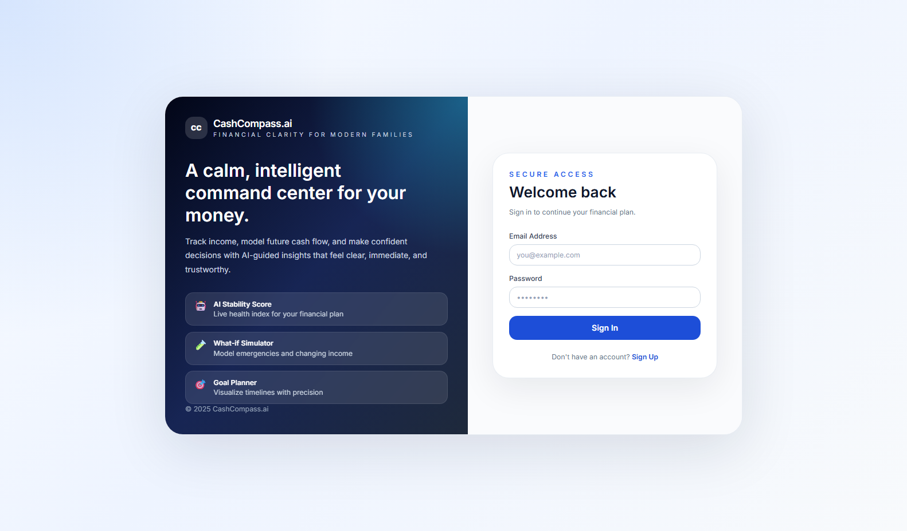
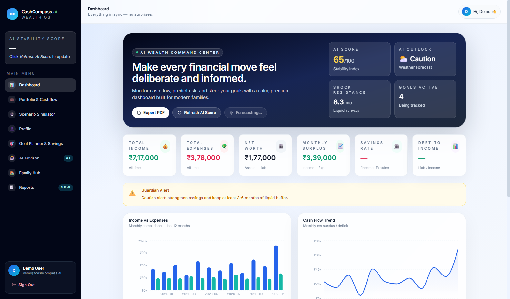
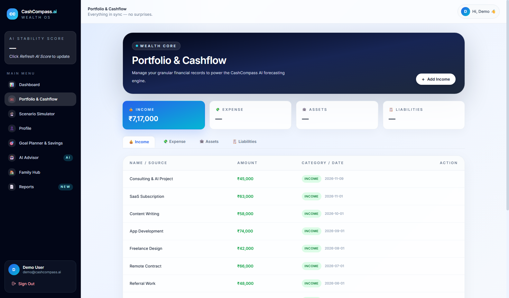
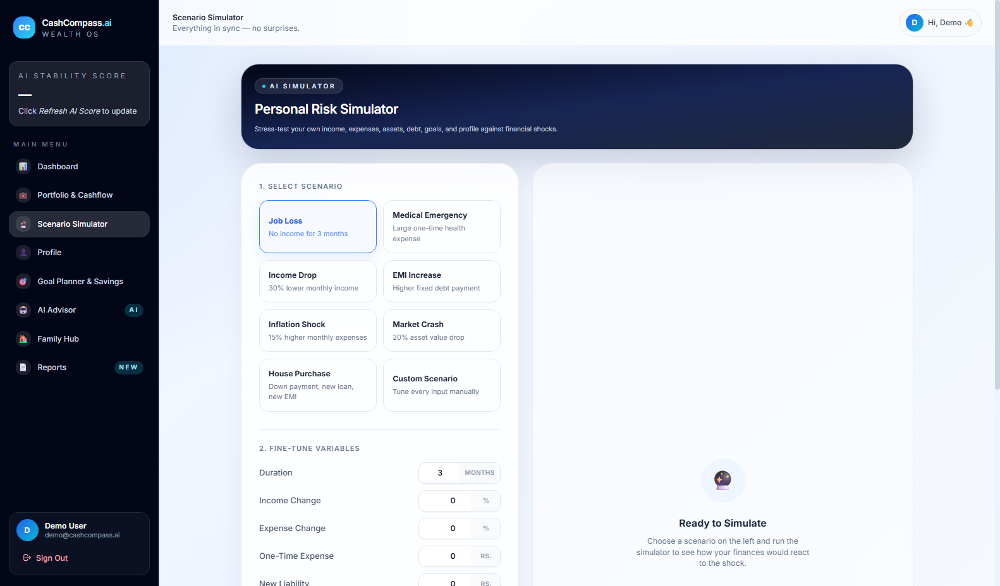
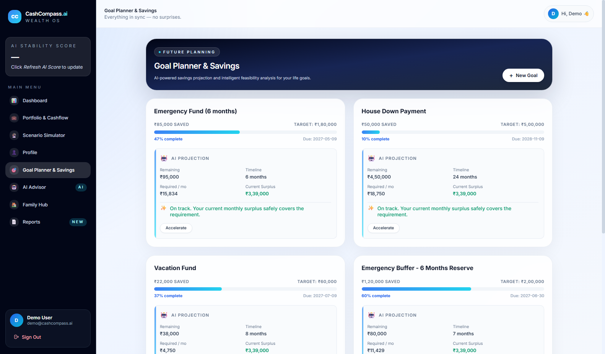
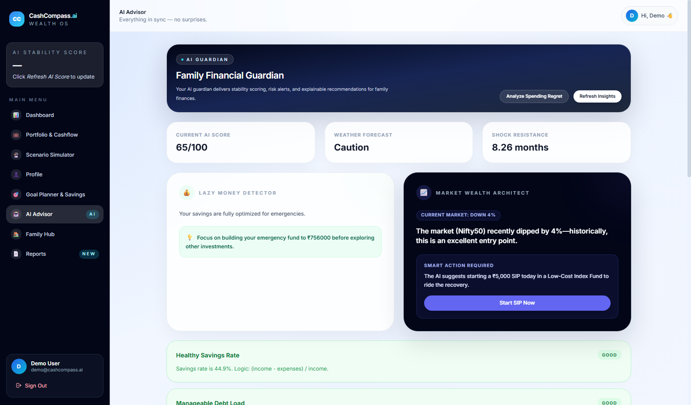
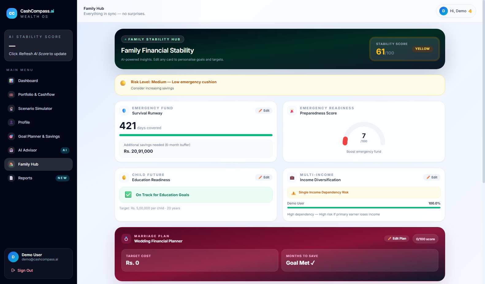
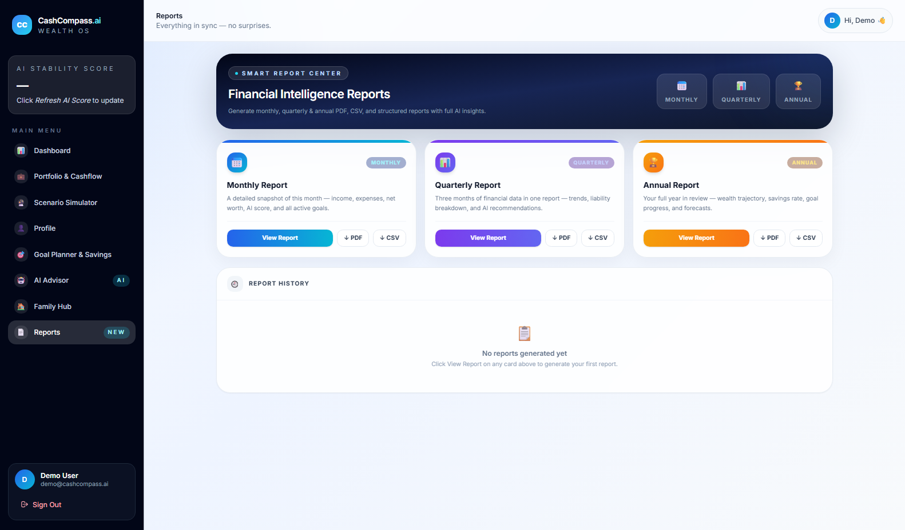
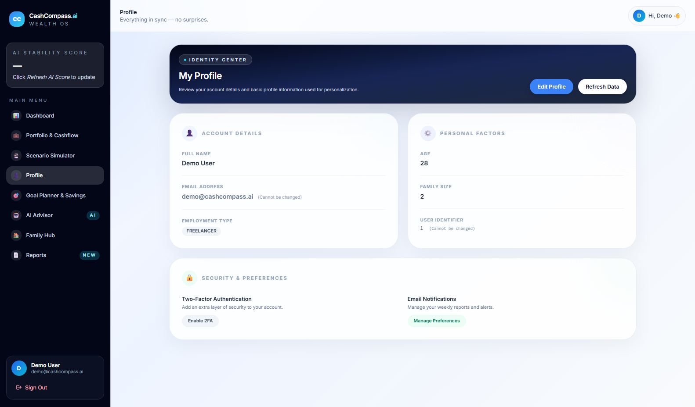

# 🧭 CashCompass: Intelligent Personal Finance Management with Predictive Analytics

CashCompass is an intelligent, full-stack personal finance and wealth management platform designed for modern individuals and families. It evaluates financial health through an AI-powered Financial Stability Index (FSI), forecasts cashflow trends using Dynamic Ensemble Machine Learning (XGBoost, Random Forest, Gradient Boosting, Ridge Regression), runs stress scenario simulations, and provides personalized recommendations with an interactive dashboard.

---

## 📸 Screenshots & Application Showcase

### 1. Secure Authentication & Onboarding
Seamless JWT-based authentication with pre-seeded demo accounts and multi-factor safety.


### 2. AI Wealth Command Center (Dashboard)
Overview of all-time income, expenses, liquid runway, net worth trajectories, Guardian alerts, and dynamic ensemble forecasts.


### 3. Portfolio & Cashflow Tracking
Granular management of income sources, recurring expenses, liquid/fixed assets, and liabilities.


### 4. Stress Scenario Simulator
Simulate stress scenarios (such as an abrupt 30% drop in freelance income or sudden emergencies) to analyze liquid survival runway and goal impacts.


### 5. Goal Planner & Savings Vault
Track target goals (Emergency buffers, tech setups, real estate, education) with deadline tracking and required monthly contributions.


### 6. AI Advisor & Regret Minimizer
Actionable, explainable AI recommendations that analyze discretionary expenditures and suggest savings diversions to meet active targets.


### 7. Family Stability Hub
Holistic family financial resilience evaluation combining household income, dependents, emergency runway, and stability scores.


### 8. Comprehensive Report Center & PDF Export
Detailed financial breakdowns, historical analytics, and exportable financial health reports.


### 9. User Profile & Risk Preferences
Manage personal profiles, employment types (Salaried, Freelancer, Business), risk appetite, and demographic factors.


---

## 🚀 Key Features

* **🔮 Dynamic Ensemble Forecasting**: Projects income and expenses up to 6 months in advance combining XGBoost, Random Forest, Gradient Boosting, and Ridge Regression models with backtest error weighting.
* **⚡ Stress Scenario Simulator**: Dynamically calculates baseline vs. projected cashflow, liquid asset survival runway, and goal vulnerabilities under custom financial shocks.
* **⛈️ Financial Stability Index (FSI)**: Computes a comprehensive 0–100 financial health index mapped to an intuitive "financial weather forecast" (Stable ☀️, Caution ⛅, High Risk ⛈️).
* **💸 Spending Regret Optimizer**: Identifies high-friction discretionary categories and generates targeted strategies to divert savings to emergency funds.
* **🎯 Goal Vault & Planner**: Manage savings goals with automated timeline estimations, monthly gap calculations, and priority allocation.
* **🏠 Family Stability Hub**: Evaluates dependents, household coverage, and risk mitigation strategies tailored to family dynamics.
* **📄 Automated PDF Reports**: Export complete financial snapshots, forecasts, and AI recommendations with single-click PDF generation.

---

## 🛠️ Tech Stack

* **Frontend**: React 18, Vite, Tailwind CSS, Recharts, Lucide Icons, jsPDF, Axios
* **Backend**: Spring Boot 3.2.4, Java 17, Spring Data JPA, Spring Security, JWT (jjwt), H2 Database, Maven
* **AI & Predictive Analytics**: Flask (Python 3.11), Scikit-Learn, XGBoost, Pandas, NumPy

---

## 📂 Project Structure

```text
CashCompass/
├── ai-service/             # Flask ML Service (Port 5000)
│   ├── app.py              # ML endpoints (Ensemble forecasting, FSI calculation)
│   ├── requirements.txt    # Python dependencies (xgboost, scikit-learn, etc.)
│   └── venv/               # Isolated Python virtual environment
├── backend/                # Spring Boot REST API (Port 8085)
│   ├── src/main/java/      # Controllers, Services, Security, DTOs, Entities
│   ├── src/test/java/      # Integration test suite
│   ├── src/main/resources/ # application.properties, schema config
│   ├── data/               # Persistent H2 file database
│   └── pom.xml             # Maven dependencies configuration
├── frontend/               # React + Vite Client (Port 3001)
│   ├── src/components/     # UI modules (Dashboard, Simulator, AIAdvisor, etc.)
│   ├── src/services/       # API client abstractions
│   ├── package.json        # Frontend dependencies
│   └── vite.config.js      # Vite build configuration
├── docs/images/            # High-resolution application screenshots
├── setup_and_run.bat       # Helper startup script for Windows environments
└── temp_api_check.py       # Automated end-to-end integration verification suite
```

---

## ⚙️ Getting Started & Run Instructions

### Prerequisites
1. **Java Development Kit (JDK 17+)**
2. **Node.js (v18+)**
3. **Python (3.9 - 3.11)**
4. **Apache Maven (3.9+)**

### Step-by-Step Setup

#### 1. AI Service (Port 5000)
```bash
cd ai-service
python -m venv venv
venv\Scripts\activate      # Windows: venv\Scripts\activate | Unix: source venv/bin/activate
pip install -r requirements.txt
python app.py
```

#### 2. Backend Service (Port 8085)
```bash
cd backend
mvn spring-boot:run
```

#### 3. Frontend Dev Server (Port 3001)
```bash
cd frontend
npm install
npm run dev -- --port 3001
```

---

## 🔗 Port Mappings & API Endpoints

| Component | Dev URL | Port |
| :--- | :--- | :--- |
| **Frontend UI** | `http://localhost:3001` | `3001` |
| **Backend REST API** | `http://localhost:8085/api` | `8085` |
| **Swagger UI / OpenAPI** | `http://localhost:8085/swagger-ui.html` | `8085` |
| **H2 Console** | `http://localhost:8085/h2-console` | `8085` |
| **AI ML Service** | `http://localhost:5000` | `5000` |

### Default Credentials
* **Email**: `demo@cashcompass.ai`
* **Password**: `demo1234`
*(Additional pre-seeded accounts: `sana@gmail.com`, `nayana@gmail.com`, `poornima@gmail.com`)*

---

## 🧪 Integration & Automated Verification

Run the end-to-end sanity verification script:
```bash
python temp_api_check.py
```
This script tests:
* User sign-in and JWT issuance
* Dashboard summary aggregations
* Dynamic ensemble ML forecasting (`/api/ai/forecast`)
* Stability index calculation (`/api/ai/stability-score`)
* Stress scenario simulation (`/api/ai/scenario`)
* Spending regret optimization and recommendation generation
